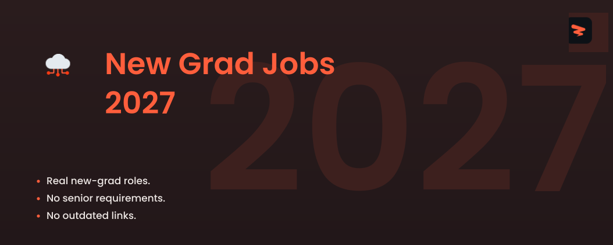

<!-- Cover -->

# New Grad Jobs 2027

🚀 New grad, intern/co-op, and adjacent early-career roles across tech, finance, healthcare, and more, updated every 10 minutes.

  
  
  
  

---

## **Website & Autofill Extension**

Explore Zapply's website and check out:

- Our Chrome extension, which autofills job applications in seconds.
- A dedicated job board featuring the latest openings across various roles.
- User accounts with multiple profiles for different resume types and roles.
- Job application tracking with streaks and commitment awards.

Experience an advanced career journey with us! 🚀

  

## Explore Around

Connect and seek advice from a growing network of fellow students and new grads.

  
  &nbsp;&nbsp;
  

---

 

<h3>💻 <strong>Software Engineering</strong></h3>

| Company | Role | Location | Posted | Visa | **Apply** |
|---------|------|----------|--------|------|----------|
| **Chamberlain Group** | Associate Product Manager (Hybrid - Oak Brook, IL) | Oak Brook, IL | Date unknown |  |  |
| **Parsons** | Software Engineer Co-Op - TS/SCI | VA, Centreville, R187147 | Date unknown |  |  |
| **Schweitzer Engineering Laboratories** | Software Engineer Intern | Washington - Pullman | Date unknown | ✅ Sponsor |  |
| **Schweitzer Engineering Laboratories** | Software Engineer Intern | Washington - Pullman | Date unknown | ✅ Sponsor |  |
| **Schweitzer Engineering Laboratories** | Software Engineer Intern | Washington - Spokane Valley | Date unknown | ✅ Sponsor |  |
| **Parsons** | Junior Software Developer - TS/SCI | VA, Herndon, R182648 | Date unknown |  |  |
| **Trace3** | DevOps | United States | Date unknown |  |  |
| **D. E. Shaw** | Product Manager — AI Vendor Tools | New York | Date unknown |  |  |
| **D. E. Shaw** | Product Manager — Legal Technology Infrastructure | New York | Date unknown |  |  |
| **D. E. Shaw** | Software Developer Intern (New York) – Summer 2027 | New York | Date unknown | ✅ Sponsor |  |
| **Impulse Space** | Flight/Embedded Software Engineering Intern (Summer 2027) | Redondo Beach, California | Date unknown |  |  |
| **Impulse Space** | Enterprise Software Engineering Intern (Summer 2027) | Redondo Beach, California | Date unknown |  |  |
| **Boom Supersonic** | Software Engineer (Early Career, Exceptional Talent) | Centennial, CO | Date unknown |  |  |
| **Mytra** | Product Manager | Brisbane, CA | Date unknown |  |  |
| **Google** | Software Engineer, AI/Machine Learning,  PhD, Early Career, 2027 Start | United States | Date unknown | ✅ Sponsor |  |
| **Google** | Software Engineer, Infrastructure, PhD, Early Career, 2027 Start | United States | Date unknown | ✅ Sponsor |  |
| **Google** | Software Engineering Intern, PhD, Summer 2027 | United States | Date unknown | ✅ Sponsor |  |
| **ByteDance** | Software Engineer intern (Global Traffic Architecture) - 2027 Summer | San Jose, California | Date unknown | ✅ Sponsor |  |
| **ByteDance** | Software Engineer Graduate (AML-Engine-Orchestration) - 2027 Start (PhD) | Seattle, Washington | Date unknown | ✅ Sponsor |  |
| **ByteDance** | Multi-Cloud CDN Scheduling Platform Engineer Graduate (CDN Platform) - 2027 Start | San Jose, California | Date unknown | ✅ Sponsor |  |
| **Cox** | Software Engineering Intern - Summer 2027 (Austin, TX) | Austin TX | 1d | ✅ Sponsor |  |
| **Emerson Electric** | Product Manager | Marshalltown, IA, United States | 1d |  |  |
| **Skydio** | Embedded Software Engineer Intern - Winter 2027 | San Mateo, California, United... | 2d | ✅ Sponsor |  |
| **RTX** | Engineer I, Software Engineer - Test Engineering (Onsite) | MN-BURNSVILLE-WEST | 2d | ✅ Sponsor |  |
| **Copart** | Software Engineering Intern | Dallas, TX - Headquarters | 2d | ✅ Sponsor |  |
| **ASML** | Platform Software Engineer In Test ( Internship) | San Jose, CA, USA | 2d | ✅ Sponsor |  |
| **ASML** | Internship - Software Engineer In Test (MOD) | San Jose, CA, USA | 2d | ✅ Sponsor |  |
| **Boeing** | Entry-Level Software Engineer | USA - Maryland Heights, MO | 2d | ✅ Sponsor |  |
| **Boeing** | Systems Software Engineer, Missile Defense National Team (Associate, Experienced, Senior) | Colorado Springs, CO | 2d | ✅ Sponsor |  |
| **Vanguard** | Product Owner, Specialist-1 | Malvern, PA | 2d |  |  |
| **Stanley Black & Decker** | Software Product Manager (FAB Field - DEWALT) | Towson, MD, United States | 2d |  |  |
| **Carrier Global** | Software Engineering Intern - Summer | CAN01: Carrier-Syracuse, 6304... | 2d |  |  |
| **Boeing** | Flight Simulation Software Engineer (Associate, Experienced, and Senior) | USA - Daytona Beach, FL | 2d | ✅ Sponsor |  |
| **Barclays** | Process, Control and Revenue Optimization Product Manager | New York, 745 7th Avenue | 2d |  |  |
| **Comcast** | Junior Backend Software Engineer (Python or PHP) - Chicago - ONSITE 2X Week- FreeWheel | IL - Chicago | 2d | ✅ Sponsor |  |
| **ICF** | Software Engineers (Generalists) | Reston, VA | 2d |  |  |
| **Zillow** | Software Development Engineer - Intern | Seattle-WA | 2d | ✅ Sponsor |  |
| **Aptiv** | Embedded Software - Engineering Intern | USA Walnut Creek, CA - WR | 2d | ✅ Sponsor |  |
| **Waymo** | 2027 Summer Intern, MS/PhD, Software Engineer, ML Frameworks and Efficiency | Mountain View, CA, USA | 2d | ✅ Sponsor |  |
| **GE Aerospace** | Executive Product Manager | Evendale | 2d |  |  |
| **Beacon Software** | Founding Product Designer | San Francisco, CA | 2d |  |  |
| **Fidelity Investments** | Product Manager – Digital User Experience | Two Destiny Way, Westlake TX | 2d |  |  |
| **Applied Materials** | 2027 Software Engineer New College Grad (Bachelor's) - Gloucester, MA | Gloucester,MA | 2d | ✅ Sponsor |  |
| **AMD** | Software Development Program Manager | Secaucus, NJ, United States | 2d |  |  |
| **Shield AI** | June 2027 Co-op - Reliability Engineering #5953 | Seattle, Washington | 2d | ✅ Sponsor |  |
| **Apple** | Product Designer | Cupertino | 2d |  |  |
| **Salesforce** | Software Engineering SMTS | California San Francisco | 2d | ✅ Sponsor |  |
| **Salesforce** | Software Engineering LMTS / PMTS - Software Factory (REMOTE) | California San Francisco | 2d | ✅ Sponsor |  |
| **Manulife** | Product Owner | USA, Massachusetts - Full Time... | 2d |  |  |
| **Microsoft** | Software Engineering IC2 | Redmond, Washington, United States | 2d | ✅ Sponsor |  |
| **KLA** | Software Engineering Intern – AI/ML for Diagnostics & Calibration | Milpitas, CA | 2d | ✅ Sponsor |  |
| **Microsoft** | Software Engineering Intern | Tulsa, Oklahoma, United States | 2d | ✅ Sponsor |  |
| **Capital One** | Manager, Cyber Security Product Manager, Cyber Intelligence | McLean, VA | 2d |  |  |
| **StubHub** | Product Manager -  Paid Search / Acquisition | New York, New York, United States | 2d |  |  |
| **CACI** | Cleared Software Engineer Intern - Summer 2027 | Denver CO US | 2d | ✅ Sponsor |  |
| **CACI** | Software Engineer Intern - Summer 2027 | Omaha, NE, US | 2d | ✅ Sponsor |  |
| **Leidos** | Junior Software Developer | St. Louis, MO | 2d | ✅ Sponsor |  |
| **Leidos** | Junior Software Developer | Huntsville, AL | 2d | ✅ Sponsor |  |
| **1Password** | Product Management Intern, End User Experience - Winter 2027 | Remote (United States  Canada) | 2d |  |  |
| **MongoDB** | 2027 - Software Engineering Intern, AMER | Austin | 2d | ✅ Sponsor |  |
| **Cisco** | Software Engineer Data & AI II (Intern) – United States | San Jose California US | 2d | ✅ Sponsor |  |
| **Cisco** | Software Engineer Full Stack / Backend I (Co-op) - United States | San Jose California US | 2d | ✅ Sponsor |  |
| **Cisco** | Software Engineer Embedded Systems I (Co-op) - United States | San Jose California US | 2d | ✅ Sponsor |  |
| **OpenAI** | Product Designer, Growth | San Francisco | 2d |  |  |
| **Amazon.com Services LLC** | Software Development Engineer Intern, Amazon Leo - Summer 2027 (USA) | Redmond, WA | 2d | ✅ Sponsor |  |
| **JPMorgan Chase** | Spectrum Core Product Manager | New York, NY, United States | 2d |  |  |
| **JPMorgan Chase** | Product Manager - Identity & Access Management | Jersey City, NJ, United States | 2d |  |  |
| **JPMorgan Chase** | Personalization Product Manager – Data Platform | New York, NY, United States | 2d |  |  |
| **Honeywell** | S4 Product Owner Innovation to Order | Atlanta, GA, United States | 2d |  |  |
| **Emerson Electric** | Product Manager | Austin, TX, United States | 2d |  |  |
| **Rivian and Volkswagen Group Technologies** | Software Engineering Intern - Vehicle Controls (Summer 2027) | Palo Alto, California | 2d | ✅ Sponsor |  |
| **Rivian and Volkswagen Group Technologies** | Software Engineering Intern - Embedded Platforms (Summer 2027) | Palo Alto, California | 2d | ✅ Sponsor |  |
| **Rivian and Volkswagen Group Technologies** | Software Engineering Intern - Connected Systems (Summer 2027) | Palo Alto, California | 2d | ✅ Sponsor |  |
| **Palantir** | Forward Deployed Software Engineer, Internship - Warp Speed | New York, NY | 3d | ✅ Sponsor |  |
| **Palantir** | Forward Deployed Software Engineer, New Grad - Warp Speed | New York, NY | 3d | ✅ Sponsor |  |
| **True Anomaly** | Software Engineer I, QA (New Grad) | Denver, CO | 3d |  |  |
| **NVIDIA** | NVIDIA 2027 Internships: Systems Software Engineering | US, CA, Santa Clara | 3d | ✅ Sponsor |  |
| **Uline** | Software Development Internship - Summer 2027 | Pleasant Prairie, WI | 3d | ✅ Sponsor |  |
| **Copart** | Associate Product Manager | San Francisco, CA | 3d |  |  |
| **Patreon** | Product Manager Intern - Summer 2027 | New York | 3d |  |  |
| **Aptiv** | Software Development Intern | Troy, MI - USA | 3d | ✅ Sponsor |  |
| **Aerospace Corporation** | Junior Full Stack Engineer | Chantilly, VA | 3d |  |  |
| **Remitly** | Fullstack Software Development Engineer I, Card | Arlington Virginia, United States | 3d | ✅ Sponsor |  |
| **Skydio** | Frontend Software Engineer Intern - Summer 2027 | San Mateo, California, United... | 3d | ✅ Sponsor |  |
| **Moog** | Intern, Software Engineering | Mineral Wells, TX | 3d |  |  |
| **Apple** | Engineering Program Manager, SWE Factory | Cupertino | 3d |  |  |
| **Applied Materials** | Software Engineer, New College Grad- Master's (Chandler, AZ) | Chandler,AZ | 3d | ✅ Sponsor |  |
| **Twitch** | Undergrad Software Engineering Intern (Grad Year: Winter 2027) | San Francisco, CA | 3d | ✅ Sponsor |  |
| **Twitch** | Undergrad Software Engineering Intern (Grad Year: Spring 2028) | San Francisco, CA | 3d | ✅ Sponsor |  |
| **Blueprint Technologies** | Junior  Azure DevOps Engineer | Redmond, WA | 3d | ✅ Sponsor |  |
| **Apple** | Principle Product Manager, Search Platform | San Francisco | 3d |  |  |
| **Salesforce** | Software Engineering MTS | California San Francisco | 3d | ✅ Sponsor |  |
| **Northrop Grumman** | 2027 Cyber Software Engineer Intern - Tampa FL | United States-Florida-Tampa | 3d |  |  |
| **Northrop Grumman** | Space Systems Embedded Software Engineers - Level 3 or 4 (TS/SCI) | United States-Illinois-Rolling... | 3d |  |  |
| **CACI** | Embedded Software Engineering Co-op - Spring 2027 | Danbury, CT, US | 3d | ✅ Sponsor |  |
| **CVS Health** | Innovation & Technology Internship - Software Engineering: Platform & Applications -Summer 2027 Grad | AZ Scottsdale | 3d | ✅ Sponsor |  |
| **CVS Health** | Innovation & Technology Internship - Software Engineering: Data & Intelligence Summer 2027 Graduate | NY - New York | 3d | ✅ Sponsor |  |
| **Microsoft** | Software Engineer: Fullstack Product (Web + Services)  Intern Opportunities for University Students, | Redmond, Washington, United States | 3d | ✅ Sponsor |  |
| **Honeywell** | Reliability Engineering Intern - Bachelor's | Shreveport, LA, United States | 3d | ✅ Sponsor |  |
| **Emerson Electric** | Product Manager | Elyria, OH, United States | 3d |  |  |

Apply for more jobs at

<h3>🤖 <strong>Data, AI & Research</strong></h3>

| Company | Role | Location | Posted | Visa | **Apply** |
|---------|------|----------|--------|------|----------|
| **Vertex Pharmaceuticals** | Spring Co-Op 2027, Process Engineering Data Analytics | Boston, MA | Date unknown |  |  |
| **Parsons** | Data Scientist I | DC, Washington, R186422 | Date unknown |  |  |
| **Stevens Capital Management** | Quantitative Research Analyst Internship | Radnor, PA | Date unknown |  |  |
| **Tower Research Capital** | Quantitative Trader / Researcher - US | New York, Chicago, Charleston,... | Date unknown |  |  |
| **D. E. Shaw** | Machine Learning Researcher | New York | Date unknown | ✅ Sponsor |  |
| **D. E. Shaw** | All Positions in Quantitative Strategies | New York | Date unknown |  |  |
| **D. E. Shaw** | Quantitative Analyst Intern (New York) – Summer 2027 | New York | Date unknown |  |  |
| **Google** | AI Data Engineer I, Professional Services, Google Cloud | United States | Date unknown | ✅ Sponsor |  |
| **Google** | Data Scientist, Research Intern, PhD, Summer 2027 | United States | Date unknown | ✅ Sponsor |  |
| **Google** | Business Data Scientist Intern, PhD, Summer 2027 | United States | Date unknown | ✅ Sponsor |  |
| **ByteDance** | Research Engineer Graduate (Seed Model - AI Foundation Model Infrastructure) - 2027 Start (PhD) | Seattle, Washington | Date unknown | ✅ Sponsor |  |
| **ByteDance** | Research Scientist Graduate (Seed Model-Alignment&Preparedness) - 2027 Start | San Jose, California | Date unknown | ✅ Sponsor |  |
| **ByteDance** | Research Scientist Intern (Distributed NoSQL Database Systems) - 2027 Start (PhD) | Seattle, Washington | Date unknown | ✅ Sponsor |  |
| **Dell Technologies** | Services Data Science Graduate Intern | TX, United States | 22h |  |  |
| **Waymo** | 2027 Summer Intern, MS/PhD, Machine Learning, Driver Refinement Foundations | San Francisco, CA, USA | 1d | ✅ Sponsor |  |
| **Amperesand** | AI/ML Engineering Intern | Sunnyvale, California, United... | 1d | ✅ Sponsor |  |
| **Zillow** | Applied Scientist (Economics) Intern | Seattle-WA | 2d | ✅ Sponsor |  |
| **Magna** | Junior AI Engineer | Troy, Michigan, US | 2d | ✅ Sponsor |  |
| **KeyBank** | Data & Business Intelligence Manager | Brooklyn, OH | 2d | ✅ Sponsor |  |
| **Caterpillar** | Data Scientist I, Lens Customer Analytics | Peoria, Illinois | 2d | ✅ Sponsor |  |
| **Flagship Pioneering** | ProFound Therapeutics: AI/ML Engineering - SAGE Platform Co-Op | Cambridge, MA USA | 2d |  |  |
| **Flagship Pioneering** | ProFound Therapeutics: Bioinformatics Data Engineering Co-Op | Cambridge, MA USA | 2d |  |  |
| **CACI** | Data Engineering/Analytics Support | Norco, CA, US | 2d | ✅ Sponsor |  |
| **Amazon.com Services LLC** | Data Scientist I, Central Learning Solutions Science | Bellevue, WA | 2d | ✅ Sponsor |  |
| **JPMorgan Chase** | Quantitative Analytics \[Multiple Positions Available\] | Plano, TX, United States | 2d |  |  |
| **Rivian and Volkswagen Group Technologies** | Data Engineering Intern - AI & Analytics (Summer 2027) | Palo Alto, California | 2d | ✅ Sponsor |  |
| **NVIDIA** | NVIDIA 2027 Internships: Deep Learning Computer Architecture | US, CA, Santa Clara | 3d | ✅ Sponsor |  |
| **Genentech** | 2027 Spring Intern - Data Science & Machine Learning | South San Francisco | 3d | ✅ Sponsor |  |
| **General Motors** | R&D Researcher – AI and Machine Learning | Warren, Michigan, United States... | 3d | ✅ Sponsor |  |
| **Itron** | Intern - Data Science, Distributed Intelligence | WA | 3d | ✅ Sponsor |  |
| **Apple** | AIML - Machine Learning Researcher, MLR | Cambridge | 3d | ✅ Sponsor |  |
| **Symbotic** | Co-op- Machine Learning Ops | USA Wilmington,  MA - | 3d | ✅ Sponsor |  |
| **CACI** | Junior Data Analyst | Florham Park NJ US | 3d | ✅ Sponsor |  |
| **CACI** | Data Analytics Program Manager | Arlington, VA, US | 3d | ✅ Sponsor |  |
| **ABB** | Sales Excellence Data Analytics Intern - Summer 2027 | USA, NC, Cary | 3d | ✅ Sponsor |  |
| **CVS Health** | Medicaid Data Analytics Corporate Internship - Summer 2027 (Undergraduate) | CT - Hartford | 3d | ✅ Sponsor |  |
| **CVS Health** | Innovation & Technology Internship – Data Engineering – Summer 2027 (Graduate) | NY - New York | 3d | ✅ Sponsor |  |
| **CVS Health** | Innovation & Technology Internship – Data Engineering – Summer 2027 (Undergraduate) | NY - New York | 3d | ✅ Sponsor |  |
| **WSP** | Transportation Data Analyst Intern - Summer 2027 | Seattle, WA, United States | 3d | ✅ Sponsor |  |
| **Prudential Financial** | PGIM Quantitative Solutions, Executive Assistant (Hybrid) | Newark, NJ, USA | 4d |  |  |
| **Nasdaq** | Business Analyst Intern - 2027 Summer Internship | USA - New York City - New York | 4d |  |  |
| **USAA** | Quantitative Risk Analyst I | San Antonio | 4d |  |  |
| **Applied Materials** | 2027 Data Analytics & Business Operations Spring Co-Op or Summer Intern- Bachelor's/Master's... | Austin,TX | 4d | ✅ Sponsor |  |
| **The Travelers Companies** | Data Engineer I (Databricks, MLOps) | CT Hartford | 4d |  |  |
| **Ardian** | Data Scientist Intern - February 2027   NYC | New York | 4d |  |  |
| **Per Scholas** | Instructional Assistant (Data Analytics) | Bronx, New York, United States | 4d |  |  |
| **Cisco** | Machine Learning Engineer I (Intern) – United States | San Jose California US | 4d | ✅ Sponsor |  |
| **Cisco** | Machine Learning Engineer II (Intern) – United States | San Jose California US | 4d | ✅ Sponsor |  |
| **Avalore** | Machine Learning and Python SME | Chantilly, Virginia | 4d |  |  |
| **Thorlabs** | Data Analyst I | Newton, New Jersey | 4d |  |  |
| **Oracle** | NA Sales Representative, Data Platform - Healthcare | San Francisco, CA, United States | 4d |  |  |
| **Oracle** | NA Sales Representative, Data Platform - Professional Services Industry | Atlanta, GA, United States | 4d |  |  |
| **Anduril** | 2027 Finance Data Analyst Intern | Costa Mesa, California, United... | 4d |  |  |
| **AeroVironment** | Machine Learning Engineering Intern | Centreville, VA | 5d |  |  |
| **Sony** | Research Engineer Intern (Ethical Creative and Protective AI Lab) | New York | 5d |  |  |
| **Adobe** | 2027 Intern - Applied and Research Scientist/Engineer | San Jose | 5d | ✅ Sponsor |  |
| **Applied Materials** | Business Intelligence Analyst I, New College Grad- Bachelor's (Santa Clara, CA) | Santa Clara,CA | 5d | ✅ Sponsor |  |
| **Baxter International** | Research Scientist I | Round Lake, Illinois | 5d |  |  |
| **KLA** | Computer Vision/Machine Learning Intern | Milpitas, CA | 5d | ✅ Sponsor |  |
| **The Hartford** | Data Science Intern - Summer 2027 | Hartford, CT | 5d | ✅ Sponsor |  |
| **Micron Technology** | Intern - Machine Learning Engineering | Richardson, TX | 5d | ✅ Sponsor |  |
| **Micron Technology** | Intern - SMAI Probe AI Engineer | Boise, ID - Main Site | 5d | ✅ Sponsor |  |
| **JPMorgan Chase** | 2027 Machine Learning Center of Excellence (NLP) - Summer Associate | New York, NY, United States | 5d | ✅ Sponsor |  |
| **Marvell** | AI Data Science Intern, MS - Summer 2027 | Santa Clara, CA | 6d | ✅ Sponsor |  |
| **Waymo** | 2027 Summer Intern, PhD, Machine Learning - Simulation & Closed-Loop Training | Mountain View, California,... | 6d | ✅ Sponsor |  |
| **Apple** | Engineering Program Manager, AI and Data Platforms | Sunnyvale | 6d |  |  |
| **Carrier Global** | Data Analytics Intern - Summer | CAI23: Carrier-Indianapolis,... | 6d |  |  |
| **Scale AI** | Machine Learning Research Intern (Summer 2027) | New York, NY | 6d | ✅ Sponsor |  |
| **Johnson & Johnson** | Quality Data Science Co-Op , Summer 2027 | Cincinnati, Ohio, United States... | 6d | ✅ Sponsor |  |
| **KLA** | Tax & Data Analytics Intern | Ann Arbor, MI | 6d | ✅ Sponsor |  |
| **The Travelers Companies** | Data Engineer I (AWS, Python, GenAI) | CT Hartford | 6d |  |  |
| **Waymo** | 2027 Summer Intern, PhD, Research Scientist, Visual Reasoning | Mountain View, CA, USA | 6d | ✅ Sponsor |  |
| **Capital One** | Manager, Data Science - US Card - Marketing | McLean, VA | 6d | ✅ Sponsor |  |
| **Highmark Health** | Summer 2027 Data Analyst Undergraduate Intern | Pittsburgh PA, 15222, FAP, 5th... | 6d | ✅ Sponsor |  |
| **JPMorgan Chase** | Quantitative Trading Researcher \[Multiple Positions Available\] | New York, NY, United States | 6d |  |  |
| **Oracle** | NA Sales Representative, Data Platform SLED | Sacramento, CA, United States | 6d |  |  |
| **LSEG** | Fixed Income Quantitative Specialist | New York, United States | 1w |  |  |
| **Snowflake** | Product Marketing, AI-Powered Data Engineering Intern (Spring 2027) | CA-Menlo Park | 1w | ✅ Sponsor |  |
| **Northeastern University** | ECE Part-Time Lecturer - Artificial Intelligence (Portland) | Portland, ME | 1w | ✅ Sponsor |  |
| **Northeastern University** | ECE Part-Time Lecturer - Artificial Intelligence (Silicon Valley) | San Jose, CA | 1w | ✅ Sponsor |  |
| **Invesco** | Quantitative Strategies Research Intern | New York, New York | 1w |  |  |
| **Invesco** | Quantitative Intern - Portfolio Engineering and Analytics | Boston, Massachusetts | 1w |  |  |
| **Zoetis** | Chemistry Data Science Intern - Digital CMC Workflows | Kalamazoo - Downtown Portage Street | 1w | ✅ Sponsor |  |
| **KeyBank** | Quantitative Analytics Associate | Brooklyn, OH | 1w |  |  |
| **The Travelers Companies** | Data Engineer I (Databricks, AWS, Python) | CT Hartford | 1w |  |  |
| **S&P Global** | Machine Learning Operations Engineer I | Cambridge, MA | 1w | ✅ Sponsor |  |
| **General Motors** | 2027 Summer Intern, AI/ML Engineer, Mapping (Masters) | Warren, Michigan, United States... | 1w | ✅ Sponsor |  |
| **Duolingo** | Data Scientist, Intern | New York, NY | 1w | ✅ Sponsor |  |
| **Duolingo** | Data Scientist, Intern (PhD) | New York, NY | 1w | ✅ Sponsor |  |
| **Ashby** | Data Analytics Manager | Remote - US | 1w |  |  |
| **Tower Research Capital** | Quantitative Researcher (Mulitple Openings) | New York, New York | 1w | ✅ Sponsor |  |
| **KLA** | Research Scientist Intern - Plasma Light Source Characterization | Ann Arbor, MI | 1w | ✅ Sponsor |  |
| **Amazon.com Services LLC** | Data Scientist I, PXT Central Science | Arlington, VA | 1w | ✅ Sponsor |  |
| **Anduril** | Winter 2027 Research Engineer Co-op | Santa Ana, California, United... | 1w |  |  |
| **Nissan** | Machine Learning Research Prediction and Planning Intern - Spring 2027 - Santa Clara, CA | Santa Clara, California -... | 1w |  |  |
| **Nissan** | Machine Learning Research Intern - Spring 2027 - Santa Clara, CA | Santa Clara, California -... | 1w |  |  |
| **Nissan** | Machine Learning Research Perception Intern - Spring 2027 - Santa Clara, CA | Santa Clara, California -... | 1w |  |  |
| **NREL** | Graduate (3-12 month) Intern - Artificial Intelligence for Power System Operations | Golden, CO | 1w | ✅ Sponsor |  |
| **General Motors** | 2027 Intern - AI/ML Engineer - Capacity & Performance Engineering, Autonomous Vehicles | Sunnyvale, California, United... | 1w | ✅ Sponsor |  |
| **ICF** | 2027 Summer Intern, AI Engineer (Reston, VA) | Reston, VA | 1w |  |  |

Apply for more jobs at

<h3>🔒 <strong>Security Engineering</strong></h3>

| Company | Role | Location | Posted | Visa | **Apply** |
|---------|------|----------|--------|------|----------|
| **Guidehouse** | IT Cybersecurity Compliance Technical Associate- Campus 2027 | VA McLean | 2h |  |  |
| **Schweitzer Engineering Laboratories** | Cybersecurity Sales Manager | North Carolina Charlotte | Date unknown |  |  |
| **Parsons** | Wing Information Security Support (Located in Qatar) | Remote (Any Location), R185875 | Date unknown |  |  |
| **Impulse Space** | Information Security Intern (Summer 2027) | Redondo Beach, California | Date unknown |  |  |
| **ByteDance** | Product Security Engineer Graduate (Security BP) - 2027 Start | San Jose, California | Date unknown | ✅ Sponsor |  |
| **ByteDance** | Security Engineering Project Intern (Watermark) - 2026 Start (BS/MS) | San Jose, California | Date unknown | ✅ Sponsor |  |
| **Freddie Mac** | Offensive Security Engineers | McLean, VA | 2d | ✅ Sponsor |  |
| **Guidehouse** | Information Security Systems Officer - DoW/HOH SkillBridge 2027 | VA McLean | 2d |  |  |
| **HPE (University)** | Cybersecurity Engineering Intern | Spring, Texas, United States of... | 2d | ✅ Sponsor |  |
| **Amazon.com Services LLC** | Security Engineer I , Stores Security- Healthcare Security | Seattle, WA | 2d | ✅ Sponsor |  |
| **Nissan** | Cyber Security Intern - Summer 2027 - Smyrna, TN | Smyrna, Tennessee - United... | 3d |  |  |
| **Sierra Nevada Corporation** | Systems Security Engineer Intern - Summer 2027 (For SNC Summer 2026 Interns Only) | Hagerstown, MD | 3d |  |  |
| **CIBC** | US Region Cybersecurity Platform Service Governance Owner | Chicago, IL | 3d |  |  |
| **Capital One** | Manager, Cyber Security - Information Security Office Consultant | New York, NY | 3d |  |  |
| **CACI** | Junior Cyber Security Engineer | Colorado Springs, CO, US | 3d | ✅ Sponsor |  |
| **Amentum** | Cybersecurity Operations Controller MDX - SSFB/HSV | CO Colorado Springs | 3d |  |  |
| **Emerson Electric** | Product Security and Data Communications Manager | Pittsburgh, PA, United States | 3d |  |  |
| **Aerospace Corporation** | 2027 Hardware Security Engineering Grad Intern | El Segundo, CA | 4d |  |  |
| **Aerospace Corporation** | 2027 Hardware Security Engineering Undergrad  Intern | El Segundo, CA | 4d |  |  |
| **Caterpillar** | Secure Technology Apprentice (Cybersecurity Apprenticeship) | East Peoria Illinois | 4d | ✅ Sponsor |  |
| **Intel** | Information Security Engineer Undergraduate Intern | US, California, Folsom | 4d | ✅ Sponsor |  |
| **Emerson Electric** | OT/ICS Cybersecurity Consultant | Austin, TX, United States | 4d |  |  |
| **Illumio** | Engineering Intern, Product Security | Sunnyvale, California - | 5d | ✅ Sponsor |  |
| **Adobe** | 2027 Intern - Security Engineer | San Jose | 5d | ✅ Sponsor |  |
| **CoStar Group** | Security Engineer Intern - Arlington, VA | VA Arlington | 5d |  |  |
| **1Password** | Junior Security Engineer | Remote (United States  Canada) | 5d |  |  |
| **Amentum** | Penetration Tester 3 – TS/SCI w/Poly | MD-Columbia | 5d |  |  |
| **Honeywell** | Cyber Security Engineer I-Penetration Tester | Plymouth, MN, United States | 5d | ✅ Sponsor |  |
| **Adobe** | 2027 Intern - Security Engineer | Lehi | 6d | ✅ Sponsor |  |
| **Together AI** | Hardware Security Engineer, New Grad (2027) | San Francisco | 1w | ✅ Sponsor |  |
| **Together AI** | Hardware Security Engineer Intern (Summer 2027) | San Francisco | 1w | ✅ Sponsor |  |
| **LLNL** | Cybersecurity Undergraduate Intern - Cyber and Critical Infrastructure Summer Institute - Summer... | Livermore, CA | 1w | ✅ Sponsor |  |
| **LLNL** | Cybersecurity Graduate Intern - Cyber and Critical Infrastructure Summer Institute - Summer 2027 | Livermore, CA | 1w | ✅ Sponsor |  |
| **NREL** | Graduate (10-12 weeks) Intern - AI/ML for Cybersecurity | Golden, CO | 1w | ✅ Sponsor |  |
| **Sierra Nevada Corporation** | Systems Security Engineer I | Lone Tree, CO | 1w |  |  |
| **General Matter** | Summer 2027 Internship - Information Security Engineer | Los Angeles, CA | 1w |  |  |
| **GDIT** | Network Security Engineer Junior | USA VA Ashburn | 1w | ✅ Sponsor |  |
| **Draper** | Classified Cybersecurity/IT Internship (Summer 2027) | Cambridge, MA | 1w |  |  |
| **Bosch Group** | Information Security and Privacy Intern | Farmington Hills, MI | 1w | ✅ Sponsor |  |
| **Anthropic** | Cybersecurity Sales Specialist | San Francisco, CA  Seattle, WA... | 2w | ✅ Sponsor |  |
| **CACI** | Cyber Security Intern - Summer 2027 | Springfield, VA, US | 2w | ✅ Sponsor |  |
| **Allison Transmission** | IT Security Analyst Internship - Summer 2027 | Indianapolis, IN | 2w |  |  |
| **NREL** | Undergraduate / Graduate (Spring / Summer) Intern - Cyber Security Research – 5G | Golden, CO | 2w | ✅ Sponsor |  |
| **Graco** | Cybersecurity Intern | Dayton, Minnesota, USA | 2w | ✅ Sponsor |  |
| **Expedia Group** | Security Engineering Intern - 2027 - Seattle | Washington - Seattle | 2w | ✅ Sponsor |  |
| **Vanguard** | College to Corporate IT Internship-Risk & Security Engineer (PA) | Malvern, PA | 3w | ✅ Sponsor |  |
| **Pentair** | IT & Cybersecurity Leadership Development Internship Program -  Summer 2027 | Golden Valley, MN | 3w |  |  |
| **SeatGeek** | Security Engineer - Internship | New York, New York | 3w | ✅ Sponsor |  |
| **Federal Reserve System** | Summer 2027 Intern-Cybersecurity and Information Security | Chicago, IL | 3w |  |  |
| **Varda Space** | Cybersecurity Internship - Summer 2027 | El Segundo, California, United... | 3w |  |  |
| **Wellmark, Inc.** | Security Analyst Internship | Des Moines, IA | 3w | ✅ Sponsor |  |
| **Grant Thornton** | Cybersecurity and Privacy Associate - Summer 2027 | Los Angeles, CA, United States | 3w | ✅ Sponsor |  |
| **Copart** | Vulnerability Management Engineering Intern | Dallas, TX - Headquarters | 3w | ✅ Sponsor |  |
| **Tencent** | Cyber Security Engineer Intern | California-Palo Alto | 1mo | ✅ Sponsor |  |
| **Home Depot** | 2027 Summer Internship - Cybersecurity | STORE SUPPORT | 1mo |  |  |
| **Monolithic Power Systems** | Security Analyst Intern | San Jose, CA | 1mo | ✅ Sponsor |  |
| **Oshkosh Corporation** | Cyber Security Intern | Oshkosh, Wisconsin, United States | 1mo | ✅ Sponsor |  |
| **Crowe** | Cybersecurity Intern | Chicago, IL | 1mo |  |  |
| **Elevance Health** | Information Security Co-Op Internship – 2027 | 2 Locations | 1mo | ✅ Sponsor |  |
| **HP Inc** | Software Product Security Engineer Intern | Spring, Texas, United States of... | 1mo | ✅ Sponsor |  |
| **HP Inc** | Software Product Security Engineer Intern | Spring, Texas, United States of... | 1mo | ✅ Sponsor |  |
| **Entegris** | Cybersecurity Engineer Co-Op | Chaska, MN | 1mo | ✅ Sponsor |  |
| **CoStar Group** | Security Engineer Intern - Richmond, VA | VA Richmond | 1mo |  |  |
| **Johnson & Johnson** | Medical Device Cybersecurity Co-Op | Danvers, Massachusetts, United... | 1mo | ✅ Sponsor |  |
| **AbbVie** | 2027 Business Technology Solutions Intern - Cybersecurity (Undergraduate) | North Chicago, IL | 1mo | ✅ Sponsor |  |
| **Booz Allen Hamilton** | University – Summer 27, Enterprise Cybersecurity Vulnerability Intern | McLean, VA | 1mo | ✅ Sponsor |  |
| **Booz Allen Hamilton** | University – Summer 27, Enterprise Cybersecurity Data Loss Prevention Intern | McLean, VA | 1mo | ✅ Sponsor |  |
| **Booz Allen Hamilton** | University – Summer 27, Enterprise Cybersecurity IT Policy Intern | McLean, VA | 1mo | ✅ Sponsor |  |
| **Rocket Lab** | Security Analyst Intern Summer 2027 | Middle River, MD | 1mo |  |  |
| **Rocket Lab** | Security Analyst Intern Spring 2027 | Middle River, MD | 1mo |  |  |
| **Rocket Lab** | Security Analyst Intern Summer 2027 | Albuquerque, NM | 1mo |  |  |
| **Wellmark, Inc.** | Cyber Security Internship | Des Moines, IA | 1mo | ✅ Sponsor |  |
| **LLNL** | National Security Engineering Division (NSED) Undergraduate Intern - Summer 2027 | Livermore, CA | 2mo | ✅ Sponsor |  |
| **Varda Space** | Cybersecurity Internship - Spring 2027 | El Segundo, California, United... | 2mo |  |  |
| **Appian** | Information Security Engineer Intern | McLean, Virginia | 3mo | ✅ Sponsor |  |

Apply for more jobs at

<h3>⚙️ <strong>Hardware & Systems Engineering</strong></h3>

| Company | Role | Location | Posted | Visa | **Apply** |
|---------|------|----------|--------|------|----------|
| **Schweitzer Engineering Laboratories** | Hardware Engineering Technician | Washington - Pullman | Date unknown | ✅ Sponsor |  |
| **Schweitzer Engineering Laboratories** | Test Engineering Technician I - Swing Shift | Indiana - West Lafayette | Date unknown | ✅ Sponsor |  |
| **Schweitzer Engineering Laboratories** | Test Engineering Technician I - First Shift | Indiana - West Lafayette | Date unknown | ✅ Sponsor |  |
| **Parsons** | STRUCTURAL ENGINEER INTERN | CA, Pasadena, R187670 | Date unknown |  |  |
| **Parsons** | HVAC - Mechanical Engineer Intern - Summer 2027 | CA, Pasadena, R187605 | Date unknown |  |  |
| **Parsons** | Electrical Engineering Intern - Summer 2027 | NY, New York, R186298 | Date unknown |  |  |
| **Impulse Space** | Manufacturing Engineering Intern (Summer 2027) | Redondo Beach, California | Date unknown |  |  |
| **Impulse Space** | Propulsion Engineering Intern (Summer 2027) | Redondo Beach, California | Date unknown |  |  |
| **Impulse Space** | Electric Propulsion Engineering Intern (Summer 2027) | Redondo Beach, California | Date unknown |  |  |
| **Boom Supersonic** | Electrical or Embedded Controls Engineer (Early Career, Exceptional Talent) | Centennial, CO | Date unknown |  |  |
| **Boom Supersonic** | Manufacturing Engineer (Early Career, Exceptional Talent) | Centennial, CO | Date unknown |  |  |
| **Boom Supersonic** | Materials & Manufacturing Process Engineer (Early Career, Exceptional Talent) | Centennial, CO | Date unknown |  |  |
| **Google** | Hardware Engineering Intern, PhD, Summer 2027 | United States | Date unknown | ✅ Sponsor |  |
| **Google** | Silicon Engineer, PhD, University Graduate, 2027 Start | United States | Date unknown | ✅ Sponsor |  |
| **Google** | Silicon Engineering Intern, PhD, Summer 2027 | United States | Date unknown | ✅ Sponsor |  |
| **ByteDance** | ASIC Design Engineer Graduate (Video Silicon IP) - 2027 Start | San Jose, California | Date unknown | ✅ Sponsor |  |
| **ByteDance** | ASIC Design Engineer Graduate (Video Silicon IP) - 2027 Start | San Jose, California | Date unknown | ✅ Sponsor |  |
| **ByteDance** | ASIC Design Engineer Intern (Video Silicon IP) - 2027 Summer | San Jose, California | Date unknown | ✅ Sponsor |  |
| **Regal Rexnord** | Quality Engineer I | Radford, Virginia, United States | 2d | ✅ Sponsor |  |
| **GlobalFoundries** | Principal Engineer, Quantum Photonics Integration (2027 New College Graduate) | USA - New York - Malta | 2d | ✅ Sponsor |  |
| **GlobalFoundries** | Systems/Process Engineering, Tapeout Operations Intern (Summer 2027) | USA - Vermont - Essex Junction | 2d | ✅ Sponsor |  |
| **GlobalFoundries** | Advanced Manufacturing Engineering Intern, Process & Equipment (Summer 2027) | USA - New York - Malta | 2d | ✅ Sponsor |  |
| **Thornton Tomasetti** | Structural Engineer Intern | New York, NY, USA | 2d |  |  |
| **Sierra Nevada Corporation** | Mechanical Engineer Intern - Summer 2027 (For SNC Summer 2026 Interns Only) | Lone Tree, CO | 2d |  |  |
| **Boeing** | Systems Architect – Model Based Systems Engineer (MBSE) (Associate, Experienced or Lead) | USA - El Segundo, CA | 2d |  |  |
| **Caterpillar** | Battery Control Systems Engineering Specialist | Mossville, Illinois | 2d | ✅ Sponsor |  |
| **Micron Technology** | Intern - ATE Process Engineer, PCVD ID1 | Boise, ID - Main Site | 2d | ✅ Sponsor |  |
| **Blue Origin** | Test Engineer I - TeraWave | Greater Seattle Area | 2d |  |  |
| **Wash U** | Basic Mechanic - Enterprise Physical Operations | Washington University Danforth | 2d |  |  |
| **GE Aerospace** | Sub-Section Manager - NPI/NTI Manufacturing Engineering | Norwich | 2d |  |  |
| **Torc Robotics** | Commissioning - Systems Engineer I | Ann Arbor, MI | 2d | ✅ Sponsor |  |
| **GE Vernova** | GE Vernova Manufacturing Process Engineer Intern - Summer 2027 | Charleroi USA | 2d | ✅ Sponsor |  |
| **Carrier Global** | Systems Engineering Intern - Summer | CAI23: Carrier-Indianapolis,... | 2d |  |  |
| **Intel** | AI Hardware Engineering Intern | California Santa Clara | 2d | ✅ Sponsor |  |
| **Symbotic** | Intern - Hardware Engineer | USA Wilmington, MA - ITC | 2d | ✅ Sponsor |  |
| **Trane Technologies** | Systems Engineer Intern | St Paul, Minnesota | 2d | ✅ Sponsor |  |
| **Leidos** | Radar Signal Processing Engineers | Huntsville, AL | 2d | ✅ Sponsor |  |
| **Honeywell** | Chemistry Lab Process Engineering Intern - Bachelor's | Shreveport, LA, United States | 2d | ✅ Sponsor |  |
| **NVIDIA** | NVIDIA 2027 Internships: Hardware ASIC Design | US, CA, Santa Clara | 3d | ✅ Sponsor |  |
| **Johnson & Johnson** | Design Quality Engineer I | West Chester, Pennsylvania,... | 3d | ✅ Sponsor |  |
| **Oshkosh Corporation** | Manufacturing Engineering Intern | Spartanburg, South Carolina,... | 3d | ✅ Sponsor |  |
| **Teledyne** | Mechanical Engineering Intern - CW | Wilsonville, OR | 3d |  |  |
| **Thornton Tomasetti** | Mechanical Engineer Intern | Los Angeles, CA, USA | 3d |  |  |
| **Thornton Tomasetti** | Structural Engineer Intern | Los Angeles, CA, USA | 3d |  |  |
| **Sierra Nevada Corporation** | Systems Engineering Intern (Summer 2027) | Lone Tree, CO | 3d |  |  |
| **Sierra Nevada Corporation** | Mechanical Engineering Intern (Summer 2027) | Hagerstown, MD | 3d |  |  |
| **Boeing** | Quality Engineer (Experienced or Senior) | USA - Berkeley, MO | 3d | ✅ Sponsor |  |
| **Boeing** | Space Communications Payload Systems Engineer (Associate, Experienced, or Lead) | USA - El Segundo, CA | 3d |  |  |
| **SpaceX** | Test Specialist, Avionics (Starshield) | Hawthorne, CA | 3d | ✅ Sponsor |  |
| **Aptiv** | Manufacturing Engineering Intern – Metal Technology | Warren, OH - USA | 3d | ✅ Sponsor |  |
| **Insulet Corporation** | Co-op - Supplier Quality Engineering: January - June 2027 (Onsite) | Acton, Massachusetts | 3d | ✅ Sponsor |  |
| **Insulet Corporation** | Co-op - Supplier Quality Engineering: January - June 2027 (Onsite) | Massachusetts | 3d | ✅ Sponsor |  |
| **Insulet Corporation** | Co-op, Mechanical Engineer: January-June 2027 (Onsite) | Acton, Massachusetts | 3d | ✅ Sponsor |  |
| **Radiance Technologies** | Microelectronics Engineer Intern | Ruston, LA | 3d |  |  |
| **Blue Origin** | Summer 2027 Electrical Systems Engineering Internship - Undergraduate | Greater Seattle Area | 3d |  |  |
| **Blue Origin** | Technician - Lunar Avionics   A Shift | Greater Seattle Area | 3d |  |  |
| **Rockwell Automation** | Intern, Firmware Engineering | Milwaukee, Wisconsin, United States | 3d | ✅ Sponsor |  |
| **Moog** | Intern, Electrical Engineering | Buffalo, NY | 3d |  |  |
| **CFS Energy** | Intern - Materials Test Engineer - Summer 2027 | Devens, MA | 3d |  |  |
| **Applied Materials** | 2027 Process Engineer III New College Grad - Doctorate (Gloucester, MA) | Gloucester,MA | 3d | ✅ Sponsor |  |
| **Applied Materials** | Process Engineer I, New College Grad - Bachelors (Billerica, MA) | Billerica,MA | 3d | ✅ Sponsor |  |
| **Analog Devices** | Mechanical Engineering | US, MA, Chelmsford, Elizabeth | 3d | ✅ Sponsor |  |
| **Itron** | Intern - Electrical Engineer (Winter, 2027) | CA | 3d | ✅ Sponsor |  |
| **Motorola Solutions** | Entry Level Mechanical Engineer | Schaumburg, IL | 3d | ✅ Sponsor |  |
| **Motorola Solutions** | Mechanical Engineering Intern - Summer 2027 | Schaumburg, IL | 3d | ✅ Sponsor |  |
| **Motorola Solutions** | Presale Systems Engineer - Summer 2027 Internship | Brooklyn, NY, More... | 3d | ✅ Sponsor |  |
| **Becton Dickinson** | R&D Hardware Electrical Engineer I | USA MD - Sparks | 3d | ✅ Sponsor |  |
| **Multiply Labs** | Mechanical Engineering Co-op/Intern (Spring 2027) | San Francisco | 3d |  |  |
| **AbbVie** | 2027 Validation Engineer Co-Op (July - Dec) (Undergraduate) | Worcester, MA | 3d | ✅ Sponsor |  |
| **AbbVie** | 2027 Validation Engineering Co-Op (Jan-July) (Undergraduate) | Worcester, MA | 3d | ✅ Sponsor |  |
| **Northrop Grumman** | 2027 Systems Engineering Internship (AI Experience) - Dulles VA | United States-Virginia-Dulles | 3d |  |  |
| **Hitachi** | Test Engineering Intern | Norman, Oklahoma, United States | 3d | ✅ Sponsor |  |
| **DoorDash** | Mechanical Engineering, Intern - Labs (Summer 2027) | Oakland, CA | 3d | ✅ Sponsor |  |
| **Leidos** | Missile Systems Engineer Intern | Huntsville, AL | 3d |  |  |
| **Leidos** | Entry Level Hypersonics Systems Engineer | Huntsville, AL | 3d |  |  |
| **Abbott** | Mechanical Engineer I | United States - California - Sylmar | 3d | ✅ Sponsor |  |
| **Abbott** | Quality Engineer I | United States - California -... | 3d | ✅ Sponsor |  |
| **HPE (University)** | Test Engineer, HPC & AI Systems - (Early Career) | Spring, Texas, United States of... | 3d | ✅ Sponsor |  |
| **HPE (University)** | Electrical Hardware Engineering Intern | Chippewa Falls, Wisconsin,... | 3d | ✅ Sponsor |  |
| **HPE** | Test Engineer, HPC & AI Systems - (Early Career) | Spring, Texas, United States of... | 3d | ✅ Sponsor |  |
| **Annapurna Labs (U.S.) Inc.** | ASIC Formal Verification Engineer I, Annapurna Labs | Austin, TX | 3d | ✅ Sponsor |  |
| **Sherwin-Williams** | Controls Engineer I | Garland, TX, United States | 3d | ✅ Sponsor |  |
| **Emerson Electric** | Manufacturing Engineering Co-Op | Marshalltown, IA, United States | 3d |  |  |
| **IEM** | Manufacturing Engineer Co-Op (Spring 2027) | Jacksonville, Florida, United... | 3d |  |  |
| **Anduril** | Winter 2027 Robotics Engineer Co-op | Quincy, Massachusetts, United... | 4d |  |  |
| **Relativity Space** | Offshore Recovery Electrical Engineer I | Cape Canaveral, Florida, United... | 4d | ✅ Sponsor |  |
| **Johnson & Johnson** | Supplier Quality Engineering Coop | Milpitas, California, United... | 4d | ✅ Sponsor |  |
| **Draper** | Optoelectronics Electrical Engineering Co-Op (Spring 2027) | Cambridge, MA | 4d |  |  |
| **Regal Rexnord** | Manufacturing Engineer I | Radford, Virginia, United States | 4d |  |  |
| **NREL** | Undergraduate or Graduate (Year Round) Intern – Building Systems Engineering | Golden, CO | 4d | ✅ Sponsor |  |
| **MKS Instruments** | 2027 Spring Mechanical Engineer Undergraduate Intern/Co-op | Andover, MA | 4d |  |  |
| **MKS Instruments** | 2027 Spring Mechanical Engineer Undergraduate Intern/Co-op | Andover, MA | 4d |  |  |
| **AeroVironment** | Quality Engineering Intern | Simi Valley, CA | 4d |  |  |
| **True Anomaly** | Propulsion Engineer I (New Grad) | Denver, CO | 4d |  |  |
| **Aerospace Corporation** | 2027 Digital Signals & RF Engineering Grad Intern | El Segundo, CA | 4d |  |  |
| **Aerospace Corporation** | 2027 Digital Signals & RF Engineering Undergrad Intern | El Segundo, CA | 4d |  |  |
| **Aerospace Corporation** | 2027 Photonics Technologies Graduate Intern | El Segundo, CA | 4d |  |  |
| **BorgWarner** | Advanced Inverter Electrical Engineering Intern | Kokomo Technical | 4d | ✅ Sponsor |  |
| **Radiance Technologies** | Junior Aerospace Engineer | Beavercreek, OH | 4d |  |  |
| **Crane Co.** | Mechanical Engineer Intern | Saddle Brook, New Jersey | 4d | ✅ Sponsor |  |

Apply for more jobs at

<h3>📊 <strong>Business & Operations</strong></h3>

| Company | Role | Location | Posted | Visa | **Apply** |
|---------|------|----------|--------|------|----------|
| **Teledyne** | Procurement/Customer Service Representative | Tracy, CA | 1h |  |  |
| **Eurofins** | Chemistry Laboratory Technician I | Mounds View, MN | 1h |  |  |
| **Brown & Brown Insurance** | Account Manager - Personal Lines | Medford, OR, USA | 2h |  |  |
| **Baxter International** | Recruiter | Deerfield, Illinois | 2h |  |  |
| **AST SpaceMobile** | Composite Technician, 2nd shift, Site 2 | Midland, Texas, United States | 4h |  |  |
| **Boston Dynamics** | Robustness Test Technician | Waltham, MA | Date unknown |  |  |
| **Boston Dynamics** | R&D Robotics Technician IV | Billerica | Date unknown |  |  |
| **Chamberlain Group** | Supply Chain Specialist | Oak Brook, IL | Date unknown |  |  |
| **Vertex Pharmaceuticals** | Spring Co-Op 2027, Supply Chain Master Data Management | Boston, MA | Date unknown |  |  |
| **Vertex Pharmaceuticals** | Spring Co-Op 2027, Global Logistics | Boston, MA | Date unknown |  |  |
| **Vertex Pharmaceuticals** | Spring Co-Op 2027, Technical Operations - Packaging | Boston, MA | Date unknown |  |  |
| **Parsons** | Electronics Technician 1 | NC (Field Location), R186975 | Date unknown |  |  |
| **Parsons** | Engineering Technician 2 | FL (Field Location), R186679 | Date unknown |  |  |
| **Schweitzer Engineering Laboratories** | Equipment Maintenance Technician Intern | Idaho - Lewiston | Date unknown |  |  |
| **Schweitzer Engineering Laboratories** | Account Coordinator | Texas Boerne | Date unknown |  |  |
| **Schweitzer Engineering Laboratories** | Account Coordinator | Colorado - Lakewood | Date unknown |  |  |
| **Parsons** | Electronics Technician 1 | TX (Field Location), R187674 | Date unknown |  |  |
| **Stevens Capital Management** | Technical Recruiter | Radnor, PA | Date unknown |  |  |
| **D. E. Shaw** | Human Capital - Product Operations Associate | New York | Date unknown |  |  |
| **Impulse Space** | Space Operations Engineering Intern (Summer 2027) | Redondo Beach, California | Date unknown |  |  |
| **Impulse Space** | Supply Chain Intern (Summer 2027) | Redondo Beach, California | Date unknown |  |  |
| **Aalyria** | Recruiting Coordinator | San Francisco, CA | Date unknown |  |  |
| **American Rare Earths** | Business Development & Sales Support Specialist | Remote (United States) | Date unknown |  |  |
| **DLB Associates** | BIM Technician | Remote (United States) | Date unknown |  |  |
| **DLB Associates** | Skillbridge Commissioning Field Technician | Remote (United States) | Date unknown |  |  |
| **DLB Associates** | SkillBridge - Data Center Commissioning Field Technician | Remote (United States) | Date unknown |  |  |
| **Boom Supersonic** | Additive Manufacturing Technician (Metal LPBF) | Centennial, CO | Date unknown |  |  |
| **Boom Supersonic** | Advanced Manufacturing Technician | Centennial, CO | Date unknown |  |  |
| **Boom Supersonic** | Casting Technician | Centennial, CO | Date unknown |  |  |
| **Mytra** | Electrical PCB Technician | Brisbane, CA | Date unknown |  |  |
| **PopStroke** | Facilities/Maintenance | Winter Garden, FL | Date unknown |  |  |
| **PopStroke** | Facilities/Maintenance | Glendale, AZ | Date unknown |  |  |
| **PopStroke** | Facilities/Maintenance | Myrtle Beach, SC | Date unknown |  |  |
| **Ratio Therapeutics, Inc.** | Chemistry Laboratory Operations Associate | Boston, Massachusetts | Date unknown |  |  |
| **Sanofi** | Key Account Manager Business Solutions West Region | Remote, USA | Date unknown |  |  |
| **Sanofi** | Retail Key Account Executive | Remote, USA | Date unknown |  |  |
| **Google** | Data Center Facilities Technician, Server Floor | United States | Date unknown |  |  |
| **Google** | Technical Solutions Consultant, gTech Ads Sellside | United States | Date unknown |  |  |
| **Google** | Technical Solutions- GBO- Web Solutions Engineering (Multiple Openings) | United States | Date unknown | ✅ Sponsor |  |
| **ByteDance** | Datacenter Procurement Project Intern (Data Center Development) - 2026 Start | Seattle, Washington | Date unknown |  |  |
| **ByteDance** | Datacenter Procurement Project Intern (Data Center Development) - 2026 Start | San Jose, California | Date unknown |  |  |
| **ByteDance** | Sourcing Specialist Graduate (Supply Chain Management) - 2027 Start | San Jose, California | Date unknown |  |  |
| **SS&C Technologies** | Sales Development Representative | Jacksonville, FL | 1d |  |  |
| **ICF** | On-Call Archaeological Field Technician (Southeast US) | Raleigh, NC | 1d |  |  |
| **Apple** | CRM Campaign Operations Specialist | Cupertino | 1d |  |  |
| **Anduril** | NDT Technician | McHenry, Mississippi, United States | 1d |  |  |
| **Samsara** | Account Development Representative Intern - Phoenix | Phoenix, Arizona, United States | 1d | ✅ Sponsor |  |
| **OpenAI** | Procurement Operations Specialist | San Francisco | 1d |  |  |
| **Kohl's** | Seasonal Stockroom Operations Associate | Rocky Hill, Connecticut | 1d |  |  |
| **Muon Space** | Recruiting Coordinator | San Jose, CA | 1d |  |  |
| **GitLab** | Ecosystem Operations Specialist | Remote, United States | 1d |  |  |
| **Allegion** | Service Technician | Phoenix, AZ | 2d |  |  |
| **Allegion** | Automatic Door Service Technician | New York | 2d |  |  |
| **Amentum** | Rigger Technician | FL-Kennedy Space | 2d |  |  |
| **Amentum** | Engineering Technician V | VA-Norfolk | 2d |  |  |
| **Copart** | CDS Account Manager - 009 | Dallas, TX - Headquarters | 2d |  |  |
| **Thales** | Logistics Specialist | Orlando | 2d |  |  |
| **ASML** | Optical Fabrication CNC Technician Back End Days 6am – 6pm ( Thursday, Friday, Saturday,... | Wilton, CT, USA | 2d | ✅ Sponsor |  |
| **NXP** | Sales Account Manager – Automotive | San Jose | 2d |  |  |
| **Regal Rexnord** | Electronics Lab Technician I | Radford, Virginia, United States | 2d |  |  |
| **GlobalFoundries** | Talent Acquisition Specialist, Early Talent & University Recruiting (2026 New College Grad) | USA - Texas - Austin | 2d |  |  |
| **Boeing** | Entry-Level Procurement Agent-1 | Oklahoma City, OK | 2d |  |  |
| **Boeing** | Procurement Agent 2 | USA - Oklahoma City, OK | 2d |  |  |
| **S&P Global** | Market Intelligence Sales Associate Internship | New York, NY | 2d |  |  |
| **Coca-Cola** | Retail Sales Associate (Part-Time) | FL - Buena Vista | 2d |  |  |
| **Coca-Cola** | Retail Sales Associate (Part-Time) | NV - Las Vegas | 2d |  |  |
| **Clarivate** | Business Development Associate - Life Sciences & Healthcare | 121 Massachusetts | 2d |  |  |
| **LexisNexis Risk Solutions** | Product Operations Coordinator | Duluth, GA | 2d |  |  |
| **Avis Budget Group** | Lube and Tire Technician - PT | Tallahassee International Airport | 2d |  |  |
| **Avis Budget Group** | Lube and Tire Technician - FT | Kansas City International Airport | 2d |  |  |
| **Avis Budget Group** | Lube and Tire Technician - PT | Kansas City International Airport | 2d |  |  |
| **Oshkosh Corporation** | Supply Chain Intern | Spartanburg, South Carolina,... | 2d |  |  |
| **Motorola Solutions** | Sales Development Representative | Chicago, IL | 2d |  |  |
| **Blue Origin** | Electromechanical Assembly & Test Technician | Huntsville, AL | 2d |  |  |
| **Stanley Black & Decker** | DeWALT Service Technician 1st shift M-F $20/hr | Carrollton, TX, United States | 2d |  |  |
| **Becton Dickinson** | Global Technician - Intern | USA NE - Columbus | 2d |  |  |
| **Boeing** | Experienced or Senior Procurement Agent | Tukwila, WA | 2d |  |  |
| **Caterpillar** | Account Manager | Kennett Square, PA | 2d |  |  |
| **Caterpillar** | Attachments Business Development Manager | Cary, North Carolina | 2d |  |  |
| **Allstate** | Licensed Insurance Sales Representative (Remote / Home-Based) | MN - Minneapolis | 2d |  |  |
| **Allstate** | Licensed Insurance Sales Representative (Remote / Home-Based) | FL - Orlando | 2d |  |  |
| **Allstate** | Licensed Insurance Sales Representative (Remote / Home-Based) | NC - Charlotte | 2d |  |  |
| **Northrop Grumman** | U107 Sensors & Systems Technician - 5th Shift | United States-Maryland-Baltimore | 2d |  |  |
| **Northrop Grumman** | U107 Sensors & Systems Technician- 4th Shift | United States-Maryland-Baltimore | 2d |  |  |
| **Northrop Grumman** | U107 Sensors & Systems Technician - 2nd Shift | United States-Maryland-Baltimore | 2d |  |  |
| **AES Corporation** | Generation Support Engineer Intern (Summer 2027) | US, Indianapolis, IN | 2d | ✅ Sponsor |  |
| **Cigna** | Pharmacy Technician Associate Representative - CarepathRx - US Remote | United States Work at Home | 2d |  |  |
| **Cigna** | Fulfillment Pharmacy Technician Associate Representative - Express Scripts Specialty... | St. Louis, MO | 2d |  |  |
| **Eurofins** | Sample Control Technician - Eurofins Environment Testing South Central - Midland, TX | Midland, TX | 2d |  |  |
| **Relativity Space** | Vehicle Technician I | Long Beach, California, United... | 2d |  |  |
| **ABB** | Warehouse/Internal Logistics Operator | USA, MS, Senatobia | 2d |  |  |
| **Magna** | Weld Technician | St. Thomas – Formet, Ontario, CA | 2d |  |  |
| **Thomson Reuters** | Sales Development Representative - Reuters Imagen | New York, New York | 2d |  |  |
| **RELX** | Product Operations Coordinator | Duluth, GA | 2d |  |  |
| **Elevance Health** | Pharmacy Technician I – Refill & Prescription Support - BioPlus Specialty Pharmacy | FL-LAKE MARY | 2d |  |  |
| **Elevance Health** | Part-Time Pharmacy Technician, Fulfillment - BioPlus Specialty Pharmacy | AZ-CHANDLER | 2d |  |  |
| **Zoetis** | Pharma Packaging Technician 2nd Shift 2:00pm - 10:30pm Monday - Friday | Lincoln | 2d |  |  |
| **Zoetis** | Pharma Packaging Technician 2nd Shift 2:00pm - 10:30pm Monday - Friday | Lincoln | 2d |  |  |
| **Zoetis** | Aseptic Technician 1st Shift 7:30am - 4:00pm Monday - Friday | Lincoln | 2d |  |  |
| **Aerospace Corporation** | Contract Talent Acquisition Sourcer | Chantilly, VA | 2d |  |  |

Apply for more jobs at

<h3>📂 <strong>Other Jobs</strong></h3>

| Company | Role | Location | Posted | Visa | **Apply** |
|---------|------|----------|--------|------|----------|
| **ASM Global** | Event Attendant (Casual) - The Moscone Center | San Francisco, CA | 53m |  |  |
| **Apple** | US - Specialist: Seasonal, Part-time | United States | 59m |  |  |
| **S&P Global** | Associate, Bonds Data | New York, NY | 1h |  |  |
| **S&P Global** | Marketing Specialist- Enterprise Solution | New York, NY | 1h |  |  |
| **Intapp** | Client Technology Strategist (CTS) | NY New York | 1h | ✅ Sponsor |  |
| **Stanley Black & Decker** | 3rd Shift Cell Operator - Portaband Weld - $22.64/hour | Shelbyville, KY, United States | 1h |  |  |
| **Eurofins** | Operational Support Specialist I | River Falls, WI | 1h |  |  |
| **ABB** | R&D Early Career Program (US) 2027 Cohort | CT Bloomfield | 2h |  |  |
| **ABB** | Discovery Information Systems Track - 2027 | USA, NC, Cary | 2h |  |  |
| **Brown & Brown Insurance** | RV Operations Customer Service | Remote - USA | 2h |  |  |
| **Brown & Brown Insurance** | RV Operations Customer Service | Remote - USA | 2h |  |  |
| **Brown & Brown Insurance** | RV Operations Customer Service | Remote - USA | 2h |  |  |
| **Wells Fargo** | Relationship Banker - Huntsville, AL | HUNTSVILLE, AL | 2h |  |  |
| **Hudl** | Revenue Enablement Associate I | Lincoln, NE, United States | 2h |  |  |
| **Microsoft** | Partner Development Manager | United States | 4h |  |  |
| **Boston Dynamics** | Atlas Data Operations Curriculum Designer | Waltham POST | Date unknown | ✅ Sponsor |  |
| **Chamberlain Group** | Program Manager (Hybrid - Oak Brook, IL) | Oak Brook, IL | Date unknown |  |  |
| **Chamberlain Group** | Intern, Community Product Management (Summer 2027) | Oak Brook, IL | Date unknown |  |  |
| **Chamberlain Group** | Candidate Engagement Pool | Oak Brook, IL | Date unknown |  |  |
| **Vertex Pharmaceuticals** | 2027 MBA Summer Associate Intern, Medical Information, Technology and Innovation (MITI)... | Boston, MA | Date unknown |  |  |
| **Vertex Pharmaceuticals** | 2027 MBA Summer Associate Intern, Medical Information, Technology and Innovation (MITI) | Boston, MA | Date unknown |  |  |
| **Vertex Pharmaceuticals** | Spring 2027 Co-op, Global Record to Report | Boston, MA | Date unknown |  |  |
| **Parsons** | Roadway Engineer I | FL, Altamonte Springs, R187117 | Date unknown |  |  |
| **Parsons** | Personnel Security Specialist | MD, Bethesda, R187091 | Date unknown |  |  |
| **Parsons** | Schedule Management Specialist - ID or NY | ID, Boise, R186993 | Date unknown |  |  |
| **Schweitzer Engineering Laboratories** | Drafter Intern | Colorado - Lakewood | Date unknown |  |  |
| **Schweitzer Engineering Laboratories** | Engineering Intern | Texas - Houston | Date unknown | ✅ Sponsor |  |
| **Schweitzer Engineering Laboratories** | Project Engineer I | North Carolina - Charlotte | Date unknown | ✅ Sponsor |  |
| **Blackstone** | Blackstone & NYU Networking Event | New York | Date unknown |  |  |
| **Blackstone** | Real Estate - Innovation, Generalist | New York | Date unknown |  |  |
| **Blackstone** | 2027 Blackstone Private Equity Associate (San Francisco) | San Francisco | Date unknown |  |  |
| **Stevens Capital Management** | Contract Technical Sourcing Specialist | Radnor, PA | Date unknown |  |  |
| **Stevens Capital Management** | Developer Internship | Radnor, PA | Date unknown |  |  |
| **Trace3** | Cloud / Transformation | United States | Date unknown |  |  |
| **Trace3** | Data & Analytics | United States | Date unknown |  |  |
| **Trace3** | Security | United States | Date unknown |  |  |
| **D. E. Shaw** | Founder's Office: Technology Specialist | New York | Date unknown | ✅ Sponsor |  |
| **D. E. Shaw** | Technical Program Manager - Generative AI Tech Services | New York | Date unknown | ✅ Sponsor |  |
| **D. E. Shaw** | All Positions in Systems | New York | Date unknown | ✅ Sponsor |  |
| **Impulse Space** | CNC Machinist (2nd Shift) | Redondo Beach, California | Date unknown |  |  |
| **Impulse Space** | Vehicle Engineering Intern (Summer 2027) | Redondo Beach, California | Date unknown |  |  |
| **Impulse Space** | Guidance, Navigation, and Control Intern (Summer 2027) | Boulder, Colorado | Date unknown |  |  |
| **Aalyria** | Proposal Manager | Remote (Washington, District of... | Date unknown |  |  |
| **Aalyria** | Technical Program Manager, Cleared | Remote (United States) | Date unknown |  |  |
| **Aalyria** | Technical Program Manager, Commercial | Remote (United States) | Date unknown |  |  |
| **American Rare Earths** | Buyer | Wheat Ridge, CO | Date unknown |  |  |
| **American Rare Earths** | Environmental Health Safety & Sustainability Manager | Sierra Blanca, TX | Date unknown |  |  |
| **American Rare Earths** | Geology Intern (Summer 2027) | Sierra Blanca, TX | Date unknown |  |  |
| **amika** | Account Support Specialist - Contract | Brooklyn, NY | Date unknown |  |  |
| **amika** | AVP, Influencer, Communications + Cultural Strategy | Brooklyn, NY | Date unknown |  |  |
| **amika** | Influencer Community Coordinator | Brooklyn, NY | Date unknown |  |  |
| **DLB Associates** | Assistant Construction Manager - Skillbridge | Remote (United States) | Date unknown |  |  |
| **DLB Associates** | Assistant Project Manager (MEP Design) | Remote (United States) | Date unknown |  |  |
| **DLB Associates** | BAS Design Manager | Remote (United States) | Date unknown |  |  |
| **Boom Supersonic** | Global Supply Manager | Centennial, CO | Date unknown |  |  |
| **Boom Supersonic** | Receiving Inspector | Centennial, CO | Date unknown |  |  |
| **Boom Supersonic** | Summer 2027 Engineering and Tech Internship | Centennial, CO | Date unknown |  |  |
| **D-Wave Quantum** | Team Lead, USHQ Lab Operations \[580\] | Boca Raton, FL | Date unknown |  |  |
| **Mytra** | PDM & CAD Specialist | Remote (United States) | Date unknown |  |  |
| **Mytra** | Robotics Intern - Winter 2026 | Brisbane, CA | Date unknown |  |  |
| **Mytra** | Team Lead, Bot Production | Brisbane, CA | Date unknown |  |  |
| **ConceptPlus** | Instructional Systems Designer | Remote (United States) | Date unknown |  |  |
| **ConceptPlus** | Program Manager | Dayton, OH | Date unknown |  |  |
| **ConceptPlus** | Scrum Master | Remote (United States) | Date unknown |  |  |
| **PopStroke** | Assistant Controller | Jupiter, FL | Date unknown |  |  |
| **PopStroke** | Assistant General Manager | The Colony, TX | Date unknown |  |  |
| **PopStroke** | Bartender | Orlando, FL | Date unknown |  |  |
| **Emerald Youth Foundation** | General Application | Knoxville, Tennessee | Date unknown |  |  |
| **Emerald Youth Foundation** | Bus Driver | Knoxville, Tennessee | Date unknown |  |  |
| **Emerald Youth Foundation** | Volleyball Referees | Knoxville, Tennessee | Date unknown |  |  |
| **HMD Trucking Inc.** | Truck Mechanic | Brownsburg, Indiana | Date unknown |  |  |
| **HMD Trucking Inc.** | Road Service Assistant | Chicago Ridge, Illinois | Date unknown |  |  |
| **HMD Trucking Inc.** | Semi Trailer Mechanic | Chicago Ridge, Illinois | Date unknown |  |  |
| **Ratio Therapeutics, Inc.** | Your Desired Role | Boston, Massachusetts | Date unknown |  |  |
| **Sanofi** | Therapeutic Specialist Tzield, San Francisco, CA | Remote, USA | Date unknown |  |  |
| **Sanofi** | Area Business Manager Savannah GA | Remote, USA | Date unknown |  |  |
| **Google** | Data and AI Consultant, Google Cloud Consulting | United States | Date unknown |  |  |
| **Google** | Technical Program Manager, Scaled Software Enablement PMO | United States | Date unknown |  |  |
| **Google** | Forward Deployed Engineering Intern, BS/MS, Summer 2027 | United States | Date unknown | ✅ Sponsor |  |
| **ByteDance** | Student Researcher - (Seed Model -  Multimodal Interaction & World Model) – 2026 Start (PhD) | San Jose, California | Date unknown | ✅ Sponsor |  |
| **ByteDance** | Student Researcher - (Seed Model - AI Foundation Models Infrastructure) - 2026 Start | Seattle, Washington | Date unknown | ✅ Sponsor |  |
| **ByteDance** | Research Intern (AI Compute) - 2027 Start (PhD) | Seattle, Washington | Date unknown | ✅ Sponsor |  |
| **Ascension** | Registered Nurse | Franklin, WI | 22h |  |  |
| **JPMorgan Chase** | Associate Banker, 30 Hours, Arvada, CO Area - Multiple Locations | Arvada, CO, United States | 22h |  |  |
| **JPMorgan Chase** | Associate Banker, 30 Hours, South Seattle, WA Area - Multiple Locations | Tukwila, WA, United States | 22h |  |  |
| **JPMorgan Chase** | Associate Banker, 30 Hours, North Washington State Area - Multiple Locations | Marysville, WA, United States | 22h |  |  |
| **UPS** | Driver Helper | San Diego, California | 22h |  |  |
| **UPS** | Warehouse Worker/Cover Driver | Washington, Pennsylvania | 22h |  |  |
| **UPS** | Seasonal Package Delivery Driver | Dodgeville, Wisconsin | 22h |  |  |
| **Dell Technologies** | Services Analytics Graduate Intern | TX, United States | 22h |  |  |
| **Target** | Assets Protection Specialist (Retail Theft & Fraud Investigator) | Kailua Kona, HI | 1d |  |  |
| **RTX** | Material Program Manager (MPM) - Tucson, AZ | AZ-TUCSON-M09 | 1d |  |  |
| **KBR** | Area Authority (AAD) | Basra, Al Başrah, Iraq | 1d |  |  |
| **GDIT** | Maintenance Trade Helper VLS | USA VA Chesapeake | 1d |  |  |
| **TD Synnex** | Vendor Solutions Representative - CCA | Miramar Florida United States | 1d |  |  |
| **Stanley Black & Decker** | UX/UI Design Intern - Summer 2027 | Valley City, OH, United States | 1d |  |  |
| **Deutsche Bank** | Audit Associate | New York, 1 Columbus Circle | 1d |  |  |
| **DriveTime** | Sales & Operations Advisor in Training | 1354 E Main St Salem, VA 24153 | 1d |  |  |
| **Magna** | Executive Assistant | Troy, Michigan, US | 1d |  |  |
| **Broadridge** | Sorting Machine Operator | South Windsor, CT | 1d |  |  |

Apply for more jobs at

---

### Live Job Boards

  
  &nbsp;&nbsp;
  
  &nbsp;&nbsp;
  

  
  &nbsp;&nbsp;
  
  &nbsp;&nbsp;
  

### Curated Internships

  
  &nbsp;&nbsp;
  
  &nbsp;&nbsp;
  

  
  &nbsp;&nbsp;
  

### Career Resources

  
  &nbsp;&nbsp;
  

---

Add new jobs to our listings keeping in mind the following:

- Located in the US.
- Create a new issue to submit different job positions.
- Update a job by submitting an issue with the job URL and required changes.

Our team reviews within 24-48 hours and approved jobs are added to the main list!

Questions? Create a miscellaneous issue, and we'll assist! 🙏

**🎯 17462 current opportunities from 760 companies**

**Found this helpful? Give it a ⭐ to support Zapply!**

*Not affiliated with any companies listed. All applications redirect to official career pages.*

---

## Data & Reuse

Job listings are public information provided by employers, who remain responsible for their accuracy. The compilation and the added data fields (skills, degree and visa estimates, tags) are by Zapply.

You may use, share, and build on this data, including for commercial purposes, as long as you:

- Link back to this repository as the source (followed link, no nofollow).
- Credit Zapply as the data source.
- Do not resubmit the listings to third-party job aggregators or feeds.
- Do not present Zapply enrichment fields as official employer statements; they are automated estimates provided as-is, without warranty.

You may use the name Zapply to attribute the data. Please do not use the Zapply logo or imply endorsement without written permission.

Questions or a different use? Open an issue. We say yes more often than not.

---

**Last Updated**: October 25, 2026

